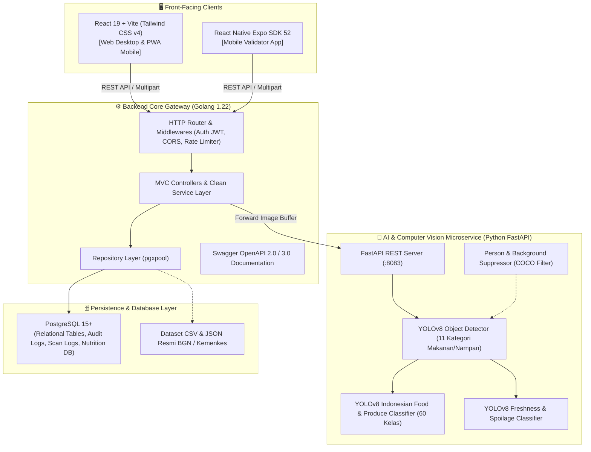

# 🥗 KawanGizi — Sistem Pemantauan Cerdas, Skrining Kelayakan Pangan AI & Akuntabilitas Distribusi Program Makan Bergizi Gratis (MBG)

[](https://go.dev/)
[](https://www.python.org/)
[](https://react.dev/)
[](https://vitejs.dev/)
[](https://fastapi.tiangolo.com/)
[](https://ultralytics.com/)
[](https://www.postgresql.org/)
[](LICENSE)

> **KawanGizi** adalah platform digital *end-to-end* yang dirancang untuk mengawal integritas, keamanan pangan, kecukupan gizi, serta akuntabilitas anggaran pada **Program Prioritas Nasional Makan Bergizi Gratis (MBG)** di bawah naungan **Badan Gizi Nasional (BGN) Republik Indonesia**.

---

## 📑 Daftar Isi

1. [Latar Belakang & Urgensi Masalah](#-latar-belakang--urgensi-masalah)
2. [Visi, Misi & Tujuan Aplikasi](#-visi-misi--tujuan-aplikasi)
3. [Fitur Unggulan Berdasarkan Peran](#-fitur-unggulan-berdasarkan-peran)
4. [Arsitektur Sistem & Alur Teknologi](#-arsitektur-sistem--alur-teknologi)
5. [Inovasi AI & Computer Vision (Two-Stage Pipeline)](#-inovasi-ai--computer-vision-two-stage-pipeline)
6. [Prasyarat Sistem (System Requirements)](#-prasyarat-sistem-system-requirements)
7. [Panduan Instalasi & Menjalankan Aplikasi (Langkah Demi Langkah)](#-panduan-instalasi--menjalankan-aplikasi-langkah-demi-langkah)
   - [Langkah 1: Kloning Repositori](#langkah-1-kloning-repositori)
   - [Langkah 2: Konfigurasi Basis Data PostgreSQL](#langkah-2-konfigurasi-basis-data-postgresql)
   - [Langkah 3: Konfigurasi & Menjalankan Backend (Golang)](#langkah-3-konfigurasi--menjalankan-backend-golang)
   - [Langkah 4: Konfigurasi & Menjalankan AI Microservice (Python)](#langkah-4-konfigurasi--menjalankan-ai-microservice-python)
   - [Langkah 5: Konfigurasi & Menjalankan Frontend Web (React + Vite)](#langkah-5-konfigurasi--menjalankan-frontend-web-react--vite)
   - [Langkah 6 (Opsional): Menjalankan Mobile Client (Expo React Native)](#langkah-6-opsional-menjalankan-mobile-client-expo-react-native)
8. [Akun Demo Pengujian (Kredensial Penjurian)](#-akun-demo-pengujian-kredensial-penjurian)
9. [Skenario Pengujian Alur Utama (Demo Flow)](#-skenario-pengujian-alur-utama-demo-flow)
10. [Dokumentasi API & Swagger](#-dokumentasi-api--swagger)
11. [Struktur Direktori Proyek](#-struktur-direktori-proyek)
12. [Dampak Sosial, Keamanan & Masa Depan (Roadmap)](#-dampak-sosial-keamanan--masa-depan-roadmap)

---

## 🎯 Latar Belakang & Urgensi Masalah

Program Makan Bergizi Gratis (MBG) menargetkan puluhan juta anak sekolah di seluruh Indonesia. Dalam skala operasional raksasa ini, muncul 4 (empat) titik kritis (*critical pain points*) di lapangan:

1. **Risiko Keamanan Pangan & Makanan Basi (*Food Safety & Spoilage Hazard*)**:
   Jeda waktu pengolahan di Satuan Pelayanan Pemenuhan Gizi (SPPG / Dapur Sentral) hingga ke meja makan siswa di sekolah dapat menurunkan suhu aman makanan hangat (*holding temperature* < 60°C), memicu pertumbuhan bakteri berbahaya, asam, atau basi.
2. **Kesesuaian Standar Gizi & Baku AKG (*Nutritional Compliance*)**:
   Sulitnya memvalidasi apakah menu riil yang tersaji di piring siswa benar-benar memenuhi standar Angka Kecukupan Gizi (AKG) nasional per jenjang usia (Fase A, B, dan C) tanpa uji laboratorium manual yang memakan waktu lama.
3. **Potensi Kebocoran & Selisih Anggaran (*Audit Discrepancy & Fraud*)**:
   Klaim penagihan porsi oleh vendor katering seringkali berbeda dengan jumlah riil boks yang diterima utuh oleh pihak sekolah, menimbulkan potensi kerugian keuangan negara pada audit BPK/BPKP.
4. **Birokrasi BAST Konvensional yang Rentan Manipulasi**:
   Berita Acara Serah Terima (BAST) manual berbasis kertas mudah hilang, terlambat dilaporkan, dan tidak memiliki integritas kriptografis untuk pencairan dana Surat Perintah Pencairan Dana (SP2D).

---

## 🚀 Visi, Misi & Tujuan Aplikasi

### Visi
> *"Mewujudkan ekosistem rantai pasok pangan anak bangsa yang transparan, aman, bergizi seimbang, dan bebas korupsi melalui integrasi kecerdasan buatan dan telemetri digital."*

### Tujuan Strategis
- **Proteksi Kesehatan Siswa**: Melindungi anak sekolah dari risiko pangan basi atau terkontaminasi melalui skrining visual AI dan audit suhu termal di gerbang sekolah.
- **Kepatuhan Gizi Presisi**: Menjamin setiap sajian memenuhi baku nutrisi (Energi Kalori, Protein, Karbohidrat, Lemak, dan Serat) sesuai database gizi resmi Kementerian Kesehatan & BGN.
- **Transparansi & Akuntabilitas Finansial**: Menyelamatkan anggaran negara dengan pencocokan otomatis (*auto-reconciliation*) antara manifes pesanan, hasil pindai boks fisik, dan nominal SP2D.
- **Efisiensi Birokrasi Terdesentralisasi**: Menerbitkan BAST digital sah berstandar tata naskah dinas berstempel kriptografis SHA-256 dan QR Code verifikasi nasional.

---

## 👥 Fitur Unggulan Berdasarkan Peran

| Peran Pengguna | Fitur & Modul Utama | Nilai Tambah |
| :--- | :--- | :--- |
| **Superadmin**<br>*(BGN Pusat / Satgas MBG)* | • Dashboard Eksekutif Nasional (Pemantauan 38 Provinsi & 514 Kab/Kota)<br>• Analitik Operasional 5W1H (Aliran Porsi, Kepatuhan AKG, Kohort Kelas)<br>• Audit Forensik & Pencegahan Kerugian Anggaran Negara<br>• Otorisasi Pembayaran Tagihan Vendor & Penerbitan SP2D Digital<br>• Generator Berkas Audit Resmi (PDF, XLSX, CSV Siap BPK) | Memberikan *single source of truth* bagi pembuat kebijakan untuk mendeteksi kecurangan dan memantau performa ribuan dapur sentral secara *real-time*. |
| **SPPG / Dapur Sentral**<br>*(Penyedia Makanan)* | • Penyusunan & Kalkulasi Resep Baku AKG Terstandarisasi<br>• Manajemen Batch, Manifes Porsi & Penerbitan Label QR Master Tote<br>• Pemantauan Titik Kendali Kritis HACCP (Suhu Masak & Suhu Kemas)<br>• Manajemen Rute Armada Pengantaran (Tote Van Cold/Warm Chain)<br>• Rekonsiliasi Tagihan Otomatis Berdasarkan BAST Sah | Memastikan proses produksi makanan di dapur memenuhi standar higienitas tertinggi dengan penelusuran (*traceability*) hingga nomor kontainer. |
| **Validator Sekolah**<br>*(Guru / Pengawas Gizi)* | • PWA & Mobile-First Interface untuk Lingkungan Lapangan<br>• Pindai Manifes QR Master Tote Termal & Uji Suhu Fisik (Batas ≥ 60°C)<br>• **Food Scan AI**: Deteksi piring nampan, klasifikasi menu & uji kesegaran<br>• **Penerbitan BAST Resmi**: Tanda tangan digital 2 pihak, stempel dinas digital, dan cetak dokumen presisi 1 lembar A4<br>• Modul Presensi Siswa & Pelaporan Cepat Insiden Alergen / Cacat Mutu<br>• Forum Komunitas Validator Se-Wilayah | Mengubah ponsel validator menjadi alat inspeksi canggih tanpa perlu perangkat sensor mahal atau formulir kertas yang merepotkan. |
| **Masyarakat & Siswa**<br>*(Transparansi Publik)* | • Portal Menu Bergizi Harian Sekolah Terbuka<br>• Rincian Komposisi Makronutrien & Informasi Alergen Transparan<br>• Uji Mandiri Kesegaran Makanan Berbasis Kamera Publik | Membangun kepercayaan publik dan orang tua terhadap program pangan pemerintah. |

---

## 🏗️ Arsitektur Sistem & Alur Teknologi

KawanGizi dibangun menggunakan pola **Microservices-Oriented Clean Architecture** dengan pemisahan tanggung jawab yang terukur:



<<<<<<< Updated upstream
## Deployment

Scan is the one feature that needs **two** running services. The Go gateway never infers anything itself; it forwards each photo to the AI service. Deploying only the gateway leaves every `POST /api/scans` returning `502`, which is the single most common production failure here.

1. Deploy the AI service (FastAPI + YOLO) and point `AI_BACKEND_URL` at its base URL. Behind a container platform it must listen on `0.0.0.0`, not the loopback default.
2. Deploy the Go gateway with that same `AI_BACKEND_URL` plus `CORS_ORIGINS` for the web origin.
3. Build the frontend with `VITE_API_BASE_URL` set to the gateway URL. When omitted the client falls back to `<host>:8080`, which does not exist behind a CDN or reverse proxy.
4. `APP_ENV=production` makes the gateway refuse to start without an explicit `AI_BACKEND_URL`, a strong `JWT_SECRET`, and `DB_SSLMODE=require`.

`render.yaml` is a ready-to-use Render blueprint for both services.

### Verifying a deployment

```bash
curl -s https://<gateway>/api/health
```

`scanReady` is the field to watch. It is `true` only when the gateway can reach the AI service *and* the AI service reports its models loaded; the `ai` object carries the URL, the latency, and the exact failure otherwise. The gateway also probes the AI service at boot and prints a warning when scanning cannot work, so the cause shows up in the deploy logs before any user hits it.

### Timeouts

`AI_REQUEST_TIMEOUT_SECONDS` bounds one inference call; `SERVER_WRITE_TIMEOUT_SECONDS` bounds the HTTP response. The write timeout is silently raised to at least 30 s above the AI timeout, because closing the socket while the model is still running reaches the user as a bare network error instead of a scan result.

## Food Scan API
=======
---
>>>>>>> Stashed changes

## 🧠 Inovasi AI & Computer Vision (Two-Stage Pipeline)

Akurasi klasifikasi hidangan lokal Indonesia seringkali terganggu bila hanya menggunakan satu model monolitik. KawanGizi menerapkan arsitektur inferensi **Two-Stage Multi-Model**:

1. **Tahap 1 — Lokalisasi Wilayah Makanan (`objek_deteksi.pt`)**:
   Model *YOLOv8 Object Detection* mendeteksi sekat nampan atau posisi makanan (`makanan_pokok`, `lauk`, `sayur`, `buah`, `minuman`). Jika foto terhalang tangan penguji, model penyaring `orang.pt` secara otomatis mengabaikan kontur non-makanan (*person suppression*).
2. **Tahap 2 — Identifikasi Menu Spesifik (`makanan_minuman.pt` & `buah.pt`)**:
   Tiap potongan objek (*bounding box crop*) diperlebar dengan *padding konteks 30%*, lalu diprediksi oleh model spesialis makanan Indonesia (34 kelas nusantara seperti Nasi Ayam Panggang, Ikan Bandeng, Sayur Sop, Tempe Bacem) atau model buah & sayur (26 kelas produce).
3. **Tahap 3 — Evaluasi Kesegaran Pangan (`cooked_food_freshness_best.pt`)**:
   Model klasifikasi terpisah menganalisis tekstur mikro, kilau minyak, perubahan warna oksidatif, dan tanda dekomposisi untuk mengeluarkan **Skor Kesegaran Visual (0-100%)** dan vonis:
   - 🟢 `layak`: Pangan segar prima, aroma dan tekstur terjaga.
   - 🟡 `peringatan`: Pangan mendekati batas kritis suhu, disarankan santap segera.
   - 🔴 `tolak`: Terindikasi basi/rusak, sistem otomatis mengunci boks dan membuka tiket insiden.
4. **Tahap 4 — Pemetaan Nutrisi Instan**:
   Nama hidangan yang teridentifikasi secara otomatis dipetakan ke tabel `nutrition_items` di PostgreSQL (disinkronkan dari dataset nutrisi kasar dan data gizi Kemenkes) untuk menghitung total Kalori, Protein, Karbohidrat, Lemak, dan Serat secara presisi.

---

## 💻 Prasyarat Sistem (System Requirements)

Pastikan lingkungan komputer atau server Anda telah terpasang perangkat lunak berikut:

| Perangkat Lunak | Versi Minimal | Fungsi Utama |
| :--- | :--- | :--- |
| **Go (Golang)** | `>= 1.22` | Server Backend API, Middleware, & Database ORM |
| **Python** | `>= 3.10` (Disarankan 3.10 / 3.11) | AI Microservice & Model Inference YOLOv8 |
| **Node.js & npm** | Node `>= 18.0.0`, npm `>= 9.0.0` | Frontend React + Vite & Mobile Expo Client |
| **PostgreSQL** | `>= 14` | Database Relasional Utama |
| **Git** | Versi terbaru | Manajemen Repositori Kode |

---

## 🛠️ Panduan Instalasi & Menjalankan Aplikasi (Langkah Demi Langkah)

Ikuti urutan langkah di bawah ini untuk menjalankan seluruh ekosistem KawanGizi secara lokal:

### Langkah 1: Kloning Repositori

```bash
git clone https://github.com/Muhfaizr21/MBG.git
cd MBG
```

---

### Langkah 2: Konfigurasi Basis Data PostgreSQL

Pastikan layanan PostgreSQL Anda telah berjalan di mesin lokal (port standar `5432`). Buka terminal psql atau GUI database favorit Anda (pgAdmin / DBeaver / TablePlus), lalu buat database dan pengguna khusus:

```sql
CREATE USER kawangizi WITH PASSWORD 'kawangizi123';
CREATE DATABASE kawangizi OWNER kawangizi;
GRANT ALL PRIVILEGES ON DATABASE kawangizi TO kawangizi;
```

> **Catatan Portabilitas**: Jika Anda menggunakan akun pengguna PostgreSQL bawaan Anda sendiri (misal `postgres`), Anda cukup menyesuaikan variabel di file konfigurasi backend.

---

### Langkah 3: Konfigurasi & Menjalankan Backend (Golang)

1. Masuk ke direktori `backend/`:
   ```bash
   cd backend
   ```
2. Buat file konfigurasi lingkungan `.env` (atau salin dari template default):
   ```bash
   cat << 'EOF' > .env
   PORT=8080
   APP_ENV=development
   DB_HOST=127.0.0.1
   DB_PORT=5432
   DB_USER=kawangizi
   DB_PASSWORD=kawangizi123
   DB_NAME=kawangizi
   DB_SSLMODE=disable
   JWT_SECRET=kawangizi-secret-kunci-enkripsi-lomba-2026
   JWT_ACCESS_TTL_MINUTES=60
   JWT_REFRESH_TTL_HOURS=168
   CORS_ORIGINS=http://localhost:5173,http://localhost:4173,http://localhost:8080,http://127.0.0.1:8080
   AI_BACKEND_URL=http://127.0.0.1:8083
   WEB_CLIENT_URL=http://localhost:5173
   NUTRITION_DATA_PATH=data/dataset_nutrisi_kasar.csv
   EOF
   ```
3. Unduh seluruh dependensi Go:
   ```bash
   go mod download
   ```
4. Jalankan backend server:
   ```bash
   go run main.go
   ```
   **Output yang diharapkan**:
   ```text
   2026/10/16 11:38:32 ✅ Seed 3 akun demo selesai
   2026/10/16 11:38:32 ✅ Seed 1346 item gizi dari data/dataset_nutrisi_kasar.csv
   🚀 Backend running at http://localhost:8080 (env: development)
   📖 Swagger UI available at http://localhost:8080/swagger/index.html
   ```
   *Backend secara otomatis menjalankan migrasi skema tabel, seeding akun demo per-role, serta sinkronisasi dataset nilai gizi ke PostgreSQL.*

---

### Langkah 4: Konfigurasi & Menjalankan AI Microservice (Python)

Buka jendela terminal baru:

1. Masuk ke direktori `backend/ai_service`:
   ```bash
   cd backend/ai_service
   ```
2. Buat dan aktifkan lingkungan virtual (*virtual environment*):
   - **macOS / Linux**:
     ```bash
     python3 -m venv venv
     source venv/bin/activate
     ```
   - **Windows (PowerShell)**:
     ```powershell
     python -m venv venv
     .\venv\Scripts\Activate.ps1
     ```
3. Pasang seluruh pustaka dependensi (PyTorch, Ultralytics YOLOv8, OpenCV, FastAPI, Uvicorn):
   ```bash
   pip install --upgrade pip
   pip install -r requirements.txt
   ```
4. Pastikan file model bobot AI telah berada di folder `backend/model_ai/`:
   - `makanan_minuman.pt` (Pengenal menu Indonesia)
   - `objek_deteksi.pt` (Detektor kompartemen nampan/makanan)
   - `cooked_food_freshness_best.pt` (Penguji kesegaran pangan)
   - `buah.pt` (Detektor sayur & buah)
   - `orang.pt` (Penyaring objek orang)
5. Jalankan layanan AI:
   ```bash
   uvicorn app.main:app --host 127.0.0.1 --port 8083
   ```
   **Output yang diharapkan**:
   ```text
   INFO:     Started server process
   INFO:     Waiting for application startup.
   INFO:     Application startup complete.
   INFO:     Uvicorn running on http://127.0.0.1:8083 (Press CTRL+C to quit)
   ```
   *Uji kesehatan AI Service di browser atau cURL: `http://127.0.0.1:8083/health`.*

---

### Langkah 5: Konfigurasi & Menjalankan Frontend Web (React + Vite)

Buka jendela terminal baru:

1. Masuk ke direktori `frontend/`:
   ```bash
   cd frontend
   ```
2. Pasang dependensi JavaScript:
   ```bash
   npm install
   ```
3. (Opsional) Konfigurasi `.env.local` jika ingin mengubah URL target API:
   ```bash
   cat << 'EOF' > .env.local
   VITE_API_BASE_URL=http://localhost:8080
   EOF
   ```
4. Jalankan development server:
   ```bash
   npm run dev
   ```
   **Output yang diharapkan**:
   ```text
     VITE v8.3.1  ready in 240 ms

     ➜  Local:   http://localhost:5173/
     ➜  Network: use --host to expose
     ➜  press h + enter to show help
   ```
5. Buka peramban Anda di **`http://localhost:5173`**.

---

### Langkah 6 (Opsional): Menjalankan Mobile Client (Expo React Native)

Jika ingin menguji aplikasi mobile validator di simulator atau perangkat fisik:

1. Buka terminal baru dan masuk ke folder `mobile/`:
   ```bash
   cd mobile
   npm install
   ```
2. Jalankan Expo dev server:
   ```bash
   npx expo start
   ```
3. Pindai QR Code menggunakan aplikasi **Expo Go** (Android / iOS) atau tekan `a` untuk Android Emulator / `i` untuk iOS Simulator.

---

## 🔑 Akun Demo Pengujian (Kredensial Penjurian)

Untuk kemudahan evaluasi dewan juri, sistem telah dilengkapi dengan 3 (tiga) akun demo dengan hak akses (*Role-Based Access Control*) yang berbeda:

| Role | Email Login | Kata Sandi | Deskripsi Hak Akses | URL Akses Langsung |
| :--- | :--- | :--- | :--- | :--- |
| **Superadmin** | `superadmin@kawangizi.id` | `SuperAdmin123!` | Akses penuh: Dashboard Nasional 5W1H, Analisis Nutrisi Makro/Mikro, Audit Forensik Tagihan Vendor, Otorisasi Pencairan Dana SP2D, Laporan BPKP. | `/dashboard` |
| **SPPG / Dapur** | `dapur@sppg01.id` | `Sppg123!` | Akses Dapur Sentral: Penyusunan Resep AKG, Rilis Batch & Label QR Tote, Log HACCP Suhu, Penjadwalan Armada Pengiriman, Invoice. | `/sppg` |
| **Validator** | `validator@sdn01menteng.sch.id` | `Validator123!` | Akses Satuan Pendidikan: Verifikasi Manifes QR Tote, Audit Suhu Lapangan, **AI Food Scan**, **Penerbitan & Cetak BAST Resmi A4**, Presensi. | `/validator` |

> 💡 **Fitur Autologin / Role Switcher**: Pada halaman login (`/login`), tersedia tombol cepat untuk masuk otomatis ke masing-masing role tanpa mengetik password secara manual.

---

## 🎬 Skenario Pengujian Alur Utama (Demo Flow)

Berikut alur simulasi yang direkomendasikan untuk mendemonstrasikan keunggulan KawanGizi:

```text
[1. Dapur SPPG] ➜ [2. Logistik Armada] ➜ [3. Gerbang Sekolah] ➜ [4. Meja Makan] ➜ [5. BGN Pusat]
  Rilis Batch      Distribusi Termal     Pindai Tote & BAST    Skrining Gizi AI    Kliring SP2D
```

1. **Simulasi Rilis Batch di Dapur Sentral (`/sppg`)**:
   - Masuk sebagai akun **SPPG**.
   - Buka menu **Batch & Label QR** (`/sppg/batches`), lihat alokasi 650 porsi ke SDN 01 Menteng Pagi dengan 13 Master Tote.
   - Amati kontrol suhu holding awal pengemasan (HACCP ≥ 65°C).
2. **Simulasi Penerimaan & Audit Termal Sekolah (`/validator/handover`)**:
   - Masuk sebagai akun **Validator**.
   - Buka menu **Serah Terima** (`/validator/handover`).
   - Lakukan verifikasi 13 kontainer termal (klik *Pindai Semua* atau input sampling suhu fisik, rata-rata 63.8°C).
   - Bubuhkan tanda tangan digital Pihak Pertama (Kurir SPPG) dan Pihak Kedua (Guru Validator).
   - Klik **Terbitkan BAST**. Amati penerbitan nomor registrasi resmi dan hash SHA-256 kriptografis.
   - Klik **"Pratinjau Dokumen"** atau **"Cetak Dokumen BAST"**: amati dokumen berstandar Tata Naskah Dinas Negara lengkap dengan Kop Garuda Pancasila, QR Code validasi, dan format pas 1 lembar A4.
3. **Simulasi Skrining Makanan AI (`/validator/foodscan` atau `/scan`)**:
   - Buka menu **Scan Hidangan**.
   - Unggah atau potret sampel porsi nampan makanan.
   - Algoritma AI akan melokalisasi kompartemen nampan, mengenali menu sajian, menampilkan skor kesegaran pangan (*Freshness Index*), dan menghitung pemenuhan baku AKG.
4. **Simulasi Audit & Kliring Keuangan Negara (`/dashboard`)**:
   - Masuk sebagai akun **Superadmin**.
   - Buka menu **Laporan & BAST** (`/dashboard/laporan`).
   - Pilih tab **Penerbitan BAST Digital** atau **Klaim Tagihan Vendor (SP2D)**.
   - Sistem mencocokkan porsi lolos AI (650) vs klaim vendor tanpa selisih, siap diotorisasi pencairan dana SP2D secara aman dan akuntabel.

---

## 📡 Dokumentasi API & Swagger

Backend Golang KawanGizi dilengkapi dokumentasi interaktif **Swagger / OpenAPI Specification**.

- **Swagger UI Web**: [http://localhost:8080/swagger/index.html](http://localhost:8080/swagger/index.html)
- **OpenAPI JSON Raw**: `http://localhost:8080/swagger/doc.json`

### Contoh Endpoint Utama:

| Method | Endpoint | Deskripsi | Akses Role |
| :--- | :--- | :--- | :--- |
| `POST` | `/api/auth/login` | Otentikasi pengguna & penerbitan token JWT | Publik |
| `POST` | `/api/auth/refresh` | Pembaruan access token via httpOnly refresh cookie | Pengguna Terotentikasi |
| `GET` | `/api/sppg/bundle` | Pengambilan data terintegrasi resep, batch, & armada SPPG | SPPG / Superadmin |
| `POST` | `/api/scans` | Pengiriman foto porsi untuk inferensi AI multi-model | Validator / SPPG |
| `GET` | `/api/validator/handover` | Manifes serah terima kontainer sekolah | Validator / Superadmin |
| `POST` | `/api/validator/bast` | Pengesahan digital & penerbitan BAST resmi | Validator |
| `GET` | `/api/reports/bast` | Rekapitulasi daftar BAST nasional untuk audit keuangan | Superadmin |
| `POST` | `/api/reports/invoices/authorize` | Otorisasi penerbitan berkas SP2D pembayaran vendor | Superadmin |

---

## 📁 Struktur Direktori Proyek

```text
MBG/
├── backend/                        # Server Backend REST API (Golang 1.22 Clean MVC)
│   ├── ai_service/                 # Microservice AI Computer Vision (FastAPI Python)
│   │   ├── app/
│   │   │   ├── main.py             # Endpoint inferensi YOLOv8 & person suppression
│   │   │   ├── labels.py           # Pemetaan kelas menu Indonesia & produce
│   │   │   └── tray.py             # Logika kompartemen nampan & crop helper
│   ├── config/                     # Manajemen konfigurasi & environment variable
│   ├── controllers/                # HTTP Handlers (Health, Auth, Scan, BAST, SPPG, dll)
│   ├── database/                   # Migrasi skema PostgreSQL, pgxpool & data seeders
│   ├── data/                       # Dataset gizi resmi (Kemenkes/BGN) & CSV operasional
│   ├── docs/                       # Berkas OpenAPI/Swagger hasil generate swag init
│   ├── middlewares/                # Autentikasi JWT, CORS, Security Headers, Audit
│   ├── model_ai/                   # Bobot model PyTorch YOLOv8 (*.pt)
│   ├── models/                     # Entitas data domain & DTO (Data Transfer Objects)
│   ├── repositories/               # Abstraksi akses basis data PostgreSQL
│   ├── routes/                     # Definisi routing REST API
│   ├── services/                   # Logika bisnis inti (Clean Architecture)
│   └── requirements.txt            # Dependensi Python untuk modul AI
│
├── frontend/                       # Klien Web SPA & PWA (React 19 + Vite + Tailwind v4)
│   ├── public/                     # Aset statis, favicon, manifest.json, Service Worker
│   ├── src/
│   │   ├── assets/                 # Ilustrasi, seni visual & gambar branding
│   │   ├── components/             # Komponen UI modular
│   │   │   ├── dashboard/          # Komponen analitik superadmin (Charts 5W1H, Reports)
│   │   │   ├── home/               # Komponen landing page publik edukatif
│   │   │   ├── layout/             # Layout Donezo, Sidebar, & Mobile Bottom Navigation
│   │   │   ├── sppg/               # Komponen modul operasional Dapur Sentral
│   │   │   └── validator/          # Dokumen BAST resmi, Camera Scanner, School Switcher
│   │   ├── context/                # AuthContext (JWT State & Session Manager)
│   │   ├── data/                   # Data fallback & mock data komprehensif
│   │   ├── lib/                    # Helper API client, role guards, & school selector
│   │   ├── pages/                  # Halaman aplikasi per-role (Admin, SPPG, Validator)
│   │   └── App.jsx                 # Client-side router & role protection guards
│   ├── package.json
│   └── vite.config.js
│
├── mobile/                         # Klien Mobile Native (React Native Expo SDK 52)
│   ├── app/                        # Expo Router Pages & Tab Navigation
│   ├── components/                 # Komponen antarmuka mobile
│   └── package.json
│
└── README.md                       # Dokumentasi resmi proyek
```

---

## 🛡️ Dampak Sosial, Keamanan & Masa Depan (Roadmap)

### Dampak Sosial & Ekonomi
- **Kesehatan Generasi Emas**: Menjamin jutaan anak menerima gizi berkualitas tinggi guna menekan angka *stunting* dan meningkatkan konsentrasi belajar.
- **Efisiensi Anggaran Negara**: Menghilangkan potensi kerugian negara akibat manipulasi jumlah porsi atau klaim fiktif melalui rekonsiliasi berbasis komputer.
- **Pemberdayaan UMKM Pangan Lokal**: SPPG dapat memprioritaskan bahan pangan dari petani dan peternak lokal dengan pencatatan digital yang transparan.

### Standar Keamanan & Perlindungan Data
- **Kriptografi SHA-256**: Setiap BAST dikunci dengan hash digital unik yang tidak dapat diubah secara retroaktif (*tamper-proof*).
- **Zero-Trust Role-Based Access Control**: Pengisolasian hak akses ketat antara admin regulator, operator dapur, dan guru sekolah.
- **Audit Trail Permanen**: Seluruh interaksi penting tercatat otomatis pada tabel `audit_logs` untuk kebutuhan audit forensik BPK/BPKP.

### Rencana Pengembangan Selanjutnya (Roadmap)
- [x] Deteksi Multi-Objek Makanan & Freshness Classification YOLOv8.
- [x] Berita Acara Serah Terima (BAST) Digital dengan Format Cetak Presisi A4.
- [x] Modul Rekonsiliasi Keuangan & SP2D Superadmin.
- [ ] Integrasi Sensor IoT Nirkabel (Bluetooth Thermocouple Probe) untuk pencatatan suhu otomatis tanpa input manual.
- [ ] Penambahan Model Estimasi Gramatur & Volume Makanan berbasis *3D Depth Camera*.
- [ ] Integrasi Tanda Tangan Elektronik Tersertifikasi BSrE (Badan Siber dan Sandi Negara).

---

<div align="center">
  <p><strong>KawanGizi — Mengawal Gizi Generasi Emas, Menjaga Integritas Bangsa.</strong></p>
  <p>Dikembangkan dengan ❤️ untuk Kemajuan Program Makan Bergizi Gratis Republik Indonesia.</p>
</div>
